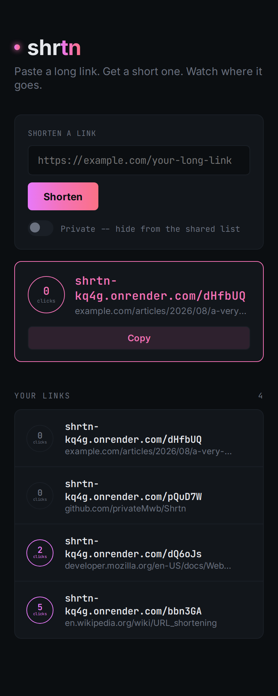
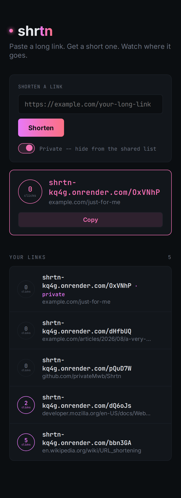
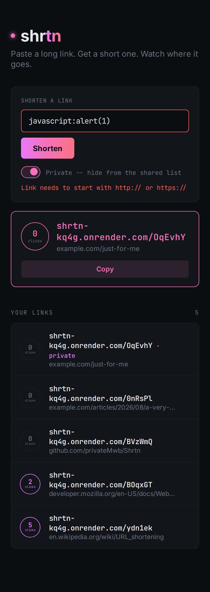
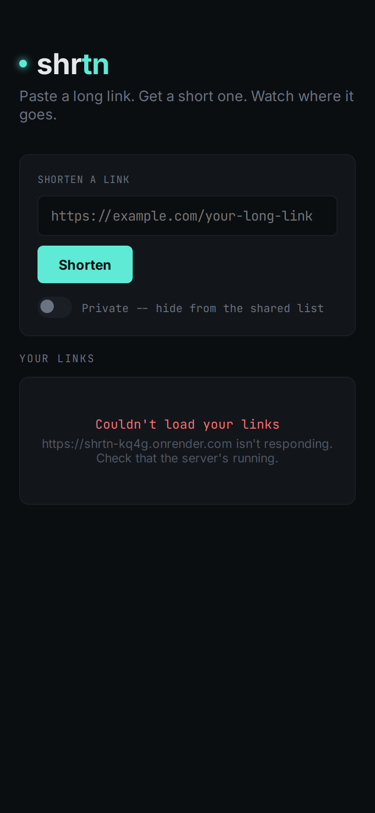
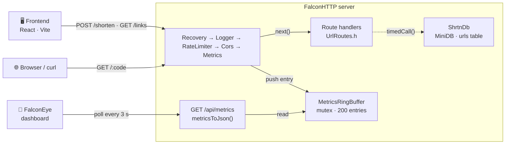
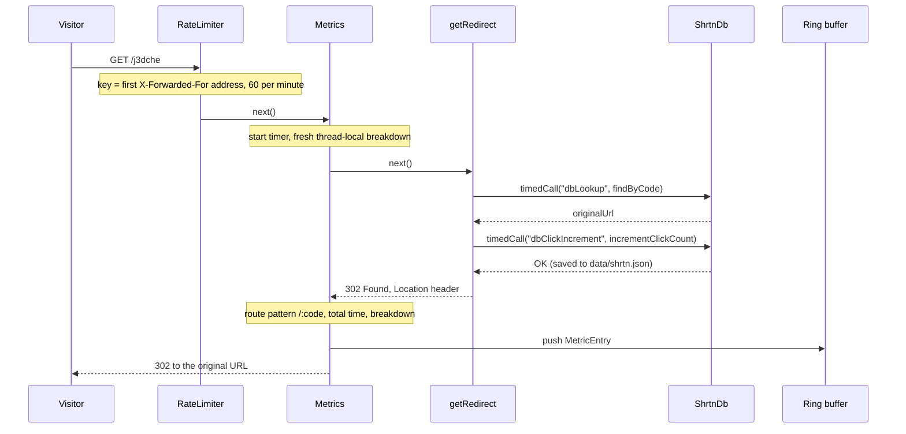

<p align="center">
  
</p>

<p align="center">
  
  
  
  
  
</p>

<p align="center">
  
</p>

<p align="center"><sub><b>CI / CD</b></sub></p>
<p align="center">
  <a href="https://github.com/privateMwb/Shrtn/actions/workflows/build.yml">
    
  </a>
  <a href="https://github.com/privateMwb/Shrtn/actions/workflows/frontend.yml">
    
  </a>
  <a href="https://github.com/privateMwb/Shrtn/actions/workflows/release.yml">
    
  </a>
</p>

<p align="center"><sub><b>Code Quality &amp; Safety</b></sub></p>
<p align="center">
  <a href="https://github.com/privateMwb/Shrtn/actions/workflows/sanitizers.yml">
    
  </a>
  <a href="https://github.com/privateMwb/Shrtn/actions/workflows/clang-tidy.yml">
    
  </a>
  <a href="https://github.com/privateMwb/Shrtn/actions/workflows/clang-format.yml">
    
  </a>
  <a href="https://github.com/privateMwb/Shrtn/actions/workflows/codeql.yml">
    
  </a>
  <a href="https://github.com/privateMwb/Shrtn/actions/workflows/cflite_pr.yml">
    
  </a>
</p>

<p align="center"><sub><b>Documentation</b></sub></p>
<p align="center">
  <a href="https://github.com/privateMwb/Shrtn/actions/workflows/docs.yml">
    
  </a>
</p>

<p align="center">
  
</p>

<p align="center">Shrtn is a URL shortener built on <a href="https://github.com/privateMwb/FalconHTTP">FalconHTTP</a> and <a href="https://github.com/privateMwb/MiniDatabase">MiniDatabase</a>: a C++ backend that turns a long URL into a random 6-character code, redirects visitors with a <code>302</code> and counts every click, paired with a React frontend for creating and browsing links. It times every request and database call with the same <code>Metrics</code> middleware as <a href="https://github.com/privateMwb/FalconEye">FalconEye</a> and serves the result at <code>/api/metrics</code>, so FalconEye's dashboard can show a live view of it <i>as it happens</i>.</p>

<br>

> [!NOTE]
> **Status: v1.0.0.** The server shortens, redirects and counts; the frontend creates and lists links;
> per-client rate limiting is on; and sanitizer runs, fuzzing and CodeQL run in CI. The live demo is at
> [shrtn-nine.vercel.app](https://shrtn-nine.vercel.app), with the backend on Render, so **links are lost
> whenever the backend is rebuilt or spins down** (see [Deployment](#deployment)). Linux only so far.

<p align="center">
  
</p>

<details>
<summary>More screenshots</summary>

<p align="center">
  
  
  
</p>

</details>

<br>

## 📑 Table of Contents

- [Features](#features)
- [How It Works](#how-it-works)
- [Requirements](#requirements)
- [Stack](#stack)
- [Installation](#installation)
- [Quick Start](#quick-start)
- [Running the Demo](#running-the-demo)
- [Frontend](#frontend)
- [API](#api)
- [Observability](#observability)
- [Docker](#docker)
- [Deployment](#deployment)
- [Project Structure](#project-structure)
- [Roadmap](#roadmap)
- [Design Notes](#design-notes)
- [Development](#development)
- [Documentation](#documentation)
- [Contributing](#contributing)
- [Changelog](#changelog)
- [Security](#security)
- [License](#license)

<br>
## <a id="features"></a>✨ Features

- **Short code generation** — random 6-character base62 codes from a thread-local `std::mt19937`, with a bounded collision retry (5 attempts). The keyspace is 62⁶ ≈ 56.8 billion, so exhausting the retries is not a realistic outcome at any scale this project would reach.
- **Click tracking** — `GET /:code` redirects with `302 Found` and increments the link's click count on every visit, as one locked read-modify-write so concurrent clicks aren't lost.
- **Private links** — `POST /shorten` accepts an optional `private` flag. Private links are absent from the shared `GET /links` listing; the creator's browser remembers the code locally and polls `GET /api/links/:code` to keep seeing its live click count. Unlisted, not access-controlled (see [Design Notes](#design-notes)).
- **Input validation with teeth** — rejects non-http(s) schemes (including `javascript:` and `data:`) and URLs over 2048 characters, both server-side. The frontend mirrors the check, but the server is the actual boundary.
- **Check-and-insert in one critical section** — a collision check and the insert happen under a single lock, because two separate locked calls would let two concurrent requests both pass the check before either inserts.
- **Per-client rate limiting** — a RateThrottle middleware allows 60 requests per minute per client, tracks up to 10,000 clients with LRU eviction, and answers `429 Too Many Requests` before anything downstream runs.
- **Built-in observability** — `Metrics`, `DbTiming.h` and `MetricsJson.h` (vendored from FalconEye) time every request, with `dbInsert`, `dbLookup` and `dbClickIncrement` breakdowns served at `/api/metrics`. The ring buffer holds 200 entries, set at the call site without editing the vendored files.
- **Route patterns, not raw paths** — metrics report `/:code`, never the code itself, so short codes don't leak through `/api/metrics`.
- **A frontend that handles real states** — loading, empty and error states for the link list, a copy-to-clipboard result card, and a list capped at the newest 50 links.
- **Tested, sanitized, and fuzzed** — a unit test suite (`shrtn_tests`) run on every compiler and build type in CI, an end-to-end smoke test, ASan, UBSan and TSan runs against the real server, and ClusterFuzzLite harnesses for URL validation, code generation and the metrics serialization path.
- **Built on its author's own libraries** — the HTTP server, the embedded database and the rate limiter are FalconHTTP, MiniDatabase and RateThrottle, all pulled in as git submodules (see [Stack](#stack)).

<div align="right"><a href="#-table-of-contents"></a></div>

## <a id="how-it-works"></a>🧠 How It Works

One server process runs FalconHTTP's middleware chain. A request is logged, rate limited, given CORS headers and timed by `Metrics`, then routed to a handler that talks to MiniDB through one mutex-guarded `ShrtnDb`.



What happens when someone follows a short link:



The request path, the locking, the data model and the trade-offs are written up in [docs/ARCHITECTURE.md](docs/ARCHITECTURE.md).

<div align="right"><a href="#-table-of-contents"></a></div>

## <a id="requirements"></a>📋 Requirements

- A C++23-conformant compiler (GCC or Clang on Linux; also run on Termux) and CMake 3.20+
- Node.js 20+ and npm, for the frontend
- Git submodules initialized: Shrtn is a consumer application built on three of its author's own projects and needs their source present to build (see [Stack](#stack))
- *(Optional)* Docker, to build the deployment image

<div align="right"><a href="#-table-of-contents"></a></div>

## <a id="stack"></a>🔗 Stack

Shrtn is assembled from three libraries, pulled in as git submodules under `server/third_party/`:

| Library | Namespace | Role |
|---|---|---|
| [FalconHTTP](https://github.com/privateMwb/FalconHTTP) | `FalconHTTP` | HTTP server, router, and the middleware chain Shrtn's routes and `Metrics` are written against |
| [MiniDatabase](https://github.com/privateMwb/MiniDatabase) | `MiniDB` | The embedded database behind the `urls` table |
| [RateThrottle](https://github.com/privateMwb/RateThrottle) | `ThrottlePro` | The rate limiter wrapped by `RateLimiterMiddleware` |

All three are built from source with `add_subdirectory()`; each one vendors its own dependencies, some as nested submodules (RateThrottle's LRUCache, for example), so there is no package manager step. The frontend is **React 18** and **Vite** with no chart or icon library: the UI is hand-styled.

<div align="right"><a href="#-table-of-contents"></a></div>

## <a id="installation"></a>📦 Installation

Clone with submodules and build the server:

```bash
git clone --recurse-submodules https://github.com/privateMwb/Shrtn.git
cd Shrtn/server
cmake -S . -B build -DCMAKE_BUILD_TYPE=Release
cmake --build build
mkdir -p data   # must exist before the first run: StorageEngine won't create it
```

Already cloned without `--recurse-submodules`? Run `git submodule update --init --recursive` from the repository root.

Then install the frontend's dependencies, from the repository root:

```bash
npm --prefix frontend install
```

Links are saved to `server/data/shrtn.json`, rewritten on every change. Delete the file to start fresh.

<div align="right"><a href="#-table-of-contents"></a></div>

## <a id="quick-start"></a>🚀 Quick Start

The fastest way to see Shrtn work is the server plus the frontend. From the repository root, with the server built:

```bash
cd server && ./build/Shrtn_server       # the server on http://localhost:8080
npm --prefix frontend run dev           # the frontend on http://localhost:5173 (second terminal)
```

Or skip the frontend and use `curl`:

```bash
# Shorten a link
curl -X POST http://localhost:8080/shorten \
  -H "Content-Type: application/json" \
  -d '{"url": "https://example.com"}'
# => {"code": "j3dche"}

# Visit it: a 302 redirect, and the click count goes up
curl -i http://localhost:8080/j3dche

# See every public link
curl http://localhost:8080/links
```

Follow [docs/DEMO.md](docs/DEMO.md) for a short guided tour. Full endpoint reference, including `private` links and the `/api/metrics` response shape: [docs/API.md](docs/API.md).

<div align="right"><a href="#-table-of-contents"></a></div>

## <a id="running-the-demo"></a>▶️ Running the Demo

One terminal per process (from the repository root):

```bash
(cd server && ./build/Shrtn_server)         # the server on :8080
npm --prefix frontend run dev               # the frontend on :5173
./scripts/smoke_test.sh http://localhost:8080   # the end-to-end check
```

Shorten a couple of links in the frontend, open one in a new tab and watch its click count rise. Tick the private toggle on another: it shows up in your own list tagged `· private`, but not in `curl localhost:8080/links`.

The server reads one environment variable:

| Variable | Purpose |
|---|---|
| `PORT` | The port to listen on (default `8080`; Render provides it) |

The frontend has one build-time setting, `VITE_API_BASE` (the server's base URL, default `http://localhost:8080`). Put it in `frontend/.env.local` for local development.

<div align="right"><a href="#-table-of-contents"></a></div>

## <a id="frontend"></a>🖥️ Frontend

```bash
npm --prefix frontend install
npm --prefix frontend run dev          # http://localhost:5173
```

<p align="center"></p>

It uses a dark palette with a magenta-to-rose gradient accent (the same three colors as the artwork above) and mono type for data. It reads `http://localhost:8080` by default; point it elsewhere with `VITE_API_BASE` at build time.

| Element | What it does |
|---|---|
| **Shorten form** | Takes a URL and a private-link toggle. The browser mirrors the server's URL check first, for a faster error; the server still rejects anything the browser lets through |
| **Result card** | Shows the new code with a copy-to-clipboard button |
| **Link list** | The newest 50 public links with click counts, in a scrollable card, with real loading, empty and error states |
| **Private links** | Remembered in the creator's browser (`localStorage`), merged into their own list tagged `· private`, and polled through `GET /api/links/:code` for live counts |

If `localStorage` is unavailable (private browsing, a full quota), the app still works: private links just aren't remembered.

<div align="right"><a href="#-table-of-contents"></a></div>

## <a id="api"></a>🔌 API

```bash
curl -X POST localhost:8080/shorten -H "Content-Type: application/json" -d '{"url": "https://example.com", "private": false}'
curl -i localhost:8080/j3dche          # 302 to the original URL; counts a click
curl localhost:8080/links              # every public link
curl localhost:8080/api/links/j3dche   # one link's metadata, public or private
curl localhost:8080/api/health         # liveness: "ok"
curl localhost:8080/api/metrics        # request timings, for FalconEye
```

| Endpoint | Purpose | Statuses |
|---|---|---|
| `POST /shorten` | Create a short link from `{"url": "...", "private": false}` | `201` with `{"code": "..."}`, `400` bad or missing URL, `500` retries exhausted or a database failure |
| `GET /:code` | Redirect and count a click | `302` with `Location`, `404` no such code |
| `GET /links` | Every **public** link: `code`, `originalUrl`, `createdAt`, `clickCount` | `200` |
| `GET /api/links/:code` | One link's metadata, including `isPrivate` | `200`, `404` |
| `GET /api/health` | Liveness check | `200` |
| `GET /api/metrics` | Rolling request metrics | `200` |

Any endpoint can also answer `429 Too Many Requests` once a client passes 60 requests in a minute.

A successful `POST /shorten` returns:

```json
{ "code": "j3dche" }
```

and `GET /links` returns an array:

```json
[
  {
    "code": "j3dche",
    "originalUrl": "https://example.com",
    "createdAt": "2026-08-12T03:14:07Z",
    "clickCount": 2
  }
]
```

There is no pagination, and no ordering guarantee from the server: the frontend sorts newest first and shows 50. Request and response details for every endpoint are in [docs/API.md](docs/API.md).

> [!WARNING]
> `GET /links` is one list shared by every visitor, and `/api/metrics` has **no authentication**: anyone who can reach the port can read recent route patterns, methods, status codes and timings. Route *patterns* are recorded, never raw paths, so short codes don't appear. See [SECURITY.md](SECURITY.md).

<div align="right"><a href="#-table-of-contents"></a></div>

## <a id="observability"></a>📡 Observability

Shrtn serves the same JSON shape as FalconEye's own example server, so FalconEye's dashboard can watch it. The dashboard polls; nothing is pushed. You can see exactly what it sees:

```bash
curl -s localhost:8080/api/metrics                                   # one snapshot
watch -n 3 "curl -s localhost:8080/api/metrics | head -c 300"        # what the dashboard does
```

To see it on the dashboard, run FalconEye's frontend and point it at Shrtn:

```bash
git clone https://github.com/privateMwb/FalconEye.git
npm --prefix FalconEye/frontend install
npm --prefix FalconEye/frontend run dev     # then open http://localhost:5173/?target=http://localhost:8080
```

Use another port if Shrtn's frontend is already on 5173. Shrtn's `Cors` middleware allows every origin, so the dashboard can read it from anywhere.

What shows up for each kind of request:

| Request | Route in the log | Breakdown steps |
|---|---|---|
| `POST /shorten` | `/shorten` | `dbInsert` |
| `GET /j3dche` | `/:code` | `dbLookup`, `dbClickIncrement` |
| `GET /links` | `/links` | none: the handler times nothing |
| `GET /nope` | `/:code`, status `404` | `dbLookup`: counts as an error |

`requestCount` is a lifetime total; `errorCount` and `avgResponseMs` describe only the last 200 requests, so an error leaves the count once 200 newer requests have arrived. The buffer holds four times as many entries as FalconEye's default of 50, so a full response is correspondingly larger, which is worth remembering if you poll it often. The shared `Metrics` code is described in [FalconEye's README](https://github.com/privateMwb/FalconEye#metrics-api).

<div align="right"><a href="#-table-of-contents"></a></div>

## <a id="docker"></a>🐳 Docker

The `Dockerfile` builds the server as a multi-stage image:

```bash
docker build -t shrtn .
docker run --rm -p 8080:8080 shrtn
./scripts/smoke_test.sh http://localhost:8080
```

- **Build stage:** an `ubuntu:24.04` image with the toolchain (`build-essential`, `cmake`, `git`) compiles `Shrtn_server` in Release mode, with the submodules' tests, benchmarks, regression suites and examples switched off.
- **Nested submodules:** `init-nested-submodules.sh` runs first. It walks the tree for every `.gitmodules` file and clones anything still empty, which is what makes the build work on hosts that clone only the top-level submodules. It needs no `.git` metadata.
- **Final stage:** a clean `ubuntu:24.04` with only `libstdc++6` and the compiled binary, to keep the image small.

> [!CAUTION]
> **`/app/data` is created inside the image layer, so it is not a persistent volume.** Everything a container stores is gone when it is rebuilt or replaced. Mount a volume at `/app/data` if you want links to survive (for example, `docker run -v shrtn-data:/app/data ...`).

<div align="right"><a href="#-table-of-contents"></a></div>

## <a id="deployment"></a>☁️ Deployment

Shrtn deploys as two independent pieces, because they are different kinds of workload:

**Frontend → Vercel.** `frontend/` is a static Vite build with no server-side logic, which suits Vercel's free Hobby tier: deploy on push, no credit card. Set `VITE_API_BASE` (Vercel project → Environment Variables) to the backend's real Render URL before deploying. It is read at build time, so changing it needs a redeploy.

**Backend → not Vercel.** `server/` is a long-running process that binds a persistent TCP port and writes `data/shrtn.json` to disk. Vercel runs short-lived serverless functions with no persistent port and no durable filesystem, so it cannot host this. The backend runs on **Render** instead, built from the repo's `Dockerfile`.

```bash
# Render:  New → Web Service, pick this repo, runtime Docker, health check path /api/health
# Vercel:  import the repo, Root Directory = frontend, set VITE_API_BASE
```

`render.yaml` is a Render Blueprint for the backend, and `frontend/vercel.json` carries the SPA rewrite and a few security headers for the frontend. Check a deployed backend from outside with `scripts/check-demo.sh <backend-url> [frontend-origin]`; the *Demo image* workflow runs the same check against the Docker image in CI. The step-by-step guide is in [docs/DEPLOYMENT.md](docs/DEPLOYMENT.md).

> [!WARNING]
> **Links are lost on every redeploy and, on Render's free plan, after every spin-down** (15 minutes without traffic), because `/app/data` is not a persistent volume. A Render persistent disk mounted at `/app/data` would fix it, at the paid tier's cost. The free plan also sleeps when idle, so the first visit after a quiet spell takes about a minute.

> [!NOTE]
> Behind Render's proxy, the rate limiter reads each visitor's address from `X-Forwarded-For`, so every visitor gets their own 60-requests-per-minute bucket. See [Design Notes](#design-notes) for what that trust assumes.

<div align="right"><a href="#-table-of-contents"></a></div>

## <a id="project-structure"></a>🗂️ Project Structure

```
Shrtn/
├── server/                 C++ backend (CMake)
│   ├── include/            Metrics.h, DbTiming.h, MetricsJson.h (vendored from FalconEye),
│   │                       ShrtnDb.h (the urls table + its mutex)
│   ├── src/
│   │   ├── middleware/     RateLimiterMiddleware.h (RateThrottle on FalconHTTP)
│   │   ├── routes/         UrlRoutes.h (/shorten, /:code, /links, /api/links/:code)
│   │   └── main.cpp        Server: middleware chain + routes on :8080
│   ├── tests/              Unit tests: ShrtnDb, URL validation, metrics, DbTiming
│   ├── fuzz/               ClusterFuzzLite harnesses (fuzz_*.cpp) and seed corpora
│   └── third_party/        The three submodules (falconhttp, minidb, ratethrottle)
│
├── frontend/               React + Vite app (vercel.json: SPA rewrite and security headers)
├── scripts/                smoke_test.sh (end-to-end check), check-demo.sh (checks a deployed
│                           backend from outside), capture-screenshots.mjs (README screenshots)
├── docs/                   ARCHITECTURE.md (how it works), DEMO.md (guided tour),
│                           DEPLOYMENT.md, API.md (endpoint reference), assets/ (screenshots)
├── .clusterfuzzlite/       Fuzzing build: Dockerfile, build.sh, project.yaml
├── .github/                Workflows, release notes, README assets, CODEOWNERS, Dependabot,
│                           rulesets/main-protection.json (branch ruleset)
│
├── Dockerfile              Backend image (multi-stage)
├── render.yaml             Render Blueprint for the backend
├── init-nested-submodules.sh   Clones submodules a host didn't recurse into
├── .dockerignore
├── .clang-format
├── .clang-tidy
├── README.md
├── CONTRIBUTING.md
├── CHANGELOG.md
├── SECURITY.md
└── LICENSE
```

<div align="right"><a href="#-table-of-contents"></a></div>

## <a id="roadmap"></a>🗺️ Roadmap

| Phase | Goal | Status |
|:-:|---|:-:|
| 0 | Repo scaffold; one build linking FalconHTTP and MiniDatabase | ✅ |
| 1 | Server bootstrap: FalconHTTP server with FalconEye's `Metrics`, `/api/health` and `/api/metrics` | ✅ |
| 2 | `POST /shorten`: URL validation, random base62 codes, bounded collision retry, MiniDB storage | ✅ |
| 3 | `GET /:code`: `302` redirect and click counting | ✅ |
| 4 | Link listing, private links, and the React frontend | ✅ |
| 5 | Hardening: URL length cap, scheme validation, locking review | ✅ |
| 6 | Stretch: CI, sanitizers, fuzzing, rate limiting, Render and Vercel deployment | ✅ <sub>no persistent storage</sub> |

<div align="right"><a href="#-table-of-contents"></a></div>

## <a id="design-notes"></a>🔬 Design Notes

No benchmark numbers are published for Shrtn: the shared `Metrics` middleware was measured in [FalconEye's design notes](https://github.com/privateMwb/FalconEye#design-notes), and Shrtn's own request cost has not been measured separately. The live numbers are in `/api/metrics`.

**Key decisions**

- **Random codes, not a counter.** Codes are six random base62 characters, so they can't be enumerated in order and need no shared counter. The cost is that collisions are possible, which the bounded retry handles.
- **Check and insert under one lock.** `tryInsertUrl()` tests for an existing code and inserts in one critical section. MiniDB's `insertRecord()` only rejects duplicate record ids, not duplicate field values, so a separate check would race.
- **One mutex around the whole database.** `Table` and `Database` aren't internally thread-safe and FalconHTTP serves requests from a thread pool, so `ShrtnDb` serializes every access. Simple and correct at this scale.
- **Persist the whole database on every write.** The simplest correct durability for this write volume. It is also the first thing to revisit if writes become a bottleneck.
- **Validate at the server.** Only `http://` and `https://` URLs of at most 2048 characters are stored, which keeps `javascript:` and `data:` targets out of any redirect. The frontend repeats the check, but only the server enforces it.
- **`GET /:code` is registered last.** FalconHTTP's router takes the first match in registration order, and `/:code` matches any one-segment path, so it must come after `/links` and the others.
- **Observability reused, not rewritten.** The three metrics headers are copies of FalconEye's, with the buffer set to 200 at the call site because `/shorten` and `/:code` traffic can fill 50 slots within seconds.
- **Rate limiting in front of everything else.** The limiter sits after `Logger` (so a `429` is still logged with its real status) and before `Cors`, `Metrics` and the handlers (so a denied request does no work).
- **One edit to a submodule.** FalconHTTP's `HttpStatus.h` gained `Found = 302`, since a redirect needs a 3xx status the enum lacked.

**Known limits** — there are no accounts and no authentication, and `GET /links` is one list shared by every visitor; private links are unlisted, not access-controlled: the code is the only barrier, and `GET /:code` and `GET /api/links/:code` never check the flag; the rate limiter keys on the first `X-Forwarded-For` address, which a caller can set to anything if they reach the server directly, and when the header is missing every caller shares one bucket; there is no schema migration path, so changing the `urls` table (as adding `isPrivate` already did once) means deleting `data/shrtn.json`; click-count increment failures are silent, since the redirect still succeeds, and nothing records them, including `/api/metrics`; `/app/data` is not a persistent volume on Render, so redeploys and free-tier spin-downs delete every link; the unit tests cover `ShrtnDb`, the URL checks and the shared metrics code, but the route handlers themselves are only exercised end to end (`scripts/smoke_test.sh`, the sanitizer jobs), and no coverage numbers are collected; `errorCount` and `avgResponseMs` describe only the latest 200 requests and reset on restart; Linux only, and nothing has been tried on macOS or MSVC.

<div align="right"><a href="#-table-of-contents"></a></div>

## <a id="development"></a>🛠️ Development

**Build the server** (Debug by default):

```bash
cd server
cmake -B build -DCMAKE_BUILD_TYPE=Debug
cmake --build build
```

**Run the frontend dev server** and **build it for production**:

```bash
cd frontend
npm run dev
npm run build
```

**Run the unit tests** (built by default; `-DSHRTN_BUILD_TESTS=OFF` skips them):

```bash
cd server
cmake --build build --target shrtn_tests
./build/shrtn_tests            # every suite; or: ./build/shrtn_tests ShrtnDb
```

**Run the smoke test** against a live instance:

```bash
./scripts/smoke_test.sh http://localhost:8080
```

**Check formatting and static analysis locally**, the same checks CI runs:

```bash
find server/include server/src \( -name "*.h" -o -name "*.cpp" \) -exec clang-format --dry-run --Werror {} +
clang-tidy -p server/build $(find server/include server/src -name "*.h" -o -name "*.cpp")
```

**Fuzzing:** every `server/fuzz/fuzz_<target>.cpp` becomes its own harness with no build-file edit (CMake option `SHRTN_BUILD_FUZZERS`), and its seed inputs go in `server/fuzz/corpus/fuzz_<target>/`. The harnesses cover URL validation and code generation, the metrics JSON, and `timedCall()`. ClusterFuzzLite runs them for a few minutes on pull requests and for longer every night.

The sanitizer workflow boots the real server under ASan/UBSan and under TSan and exercises it with real requests, including concurrent `POST /shorten` calls. See [CONTRIBUTING.md](CONTRIBUTING.md) for what CI covers.

<div align="right"><a href="#-table-of-contents"></a></div>

## <a id="documentation"></a>📖 Documentation

| Document | What's inside |
|---|---|
| [docs/ARCHITECTURE.md](docs/ARCHITECTURE.md) | How it works: the request path, locking, the data model, the frontend, fuzzing, trade-offs |
| [docs/DEMO.md](docs/DEMO.md) | A short guided tour: shorten, redirect, go private, hit the rate limit, watch it in FalconEye |
| [docs/DEPLOYMENT.md](docs/DEPLOYMENT.md) | Hosting: Render backend, Vercel frontend, behavior to expect, troubleshooting |
| [docs/API.md](docs/API.md) | Endpoint-level reference: request and response shapes, status codes |
| [CONTRIBUTING.md](CONTRIBUTING.md) | Setup, tests, code style, and the pull request checklist |
| [SECURITY.md](SECURITY.md) | Security model, scope, and how to report a vulnerability |
| [CHANGELOG.md](CHANGELOG.md) | Notable changes per release |

The generated source reference (Doxygen, from `docs/Doxyfile`) is published at **https://privateMwb.github.io/Shrtn/**.

<div align="right"><a href="#-table-of-contents"></a></div>

## <a id="contributing"></a>🤝 Contributing

Issues and pull requests are welcome. [CONTRIBUTING.md](CONTRIBUTING.md) covers setup, running the checks, code style, and a pull request checklist. In short:

- Run `clang-format` and `clang-tidy` locally (see [Development](#development)): CI enforces both
- Run `shrtn_tests` and `scripts/smoke_test.sh` against your local build before opening a pull request that touches `server/`
- If you touch `ShrtnDb`'s locking (`tryInsertUrl`, `findByCode`, `incrementClickCount`), say in the pull request how you checked it under concurrent load. The TSan job in `sanitizers.yml` is the closest regression check today

<div align="right"><a href="#-table-of-contents"></a></div>

## <a id="changelog"></a>📝 Changelog

Notable changes are recorded in [CHANGELOG.md](CHANGELOG.md); release notes are published on the [Releases](https://github.com/privateMwb/Shrtn/releases) page.

<div align="right"><a href="#-table-of-contents"></a></div>

## <a id="security"></a>🔒 Security

Please don't report a suspected vulnerability in a public issue. Use GitHub's private reporting instead: this repository's **Security** tab, then **Report a vulnerability**, so it can be fixed before it's disclosed. Details are in [SECURITY.md](SECURITY.md).

> [!WARNING]
> Shrtn has **no accounts or authentication**, private links are only unlisted, `/api/metrics` is open, and there is no TLS unless a proxy provides it. Read the security model in [SECURITY.md](SECURITY.md) before exposing an instance to people you don't trust: a shortener can hide where a link leads.

<div align="right"><a href="#-table-of-contents"></a></div>

## <a id="license"></a>📄 License

MIT — see [LICENSE](LICENSE) for details.

<p align="center">
  <sub>Built with C++23 and React</sub>
</p>

<p align="center">
  <a href="#-table-of-contents"></a>
</p>
